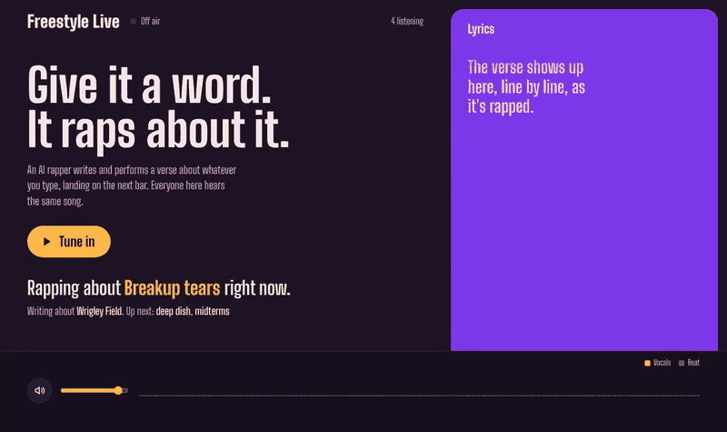
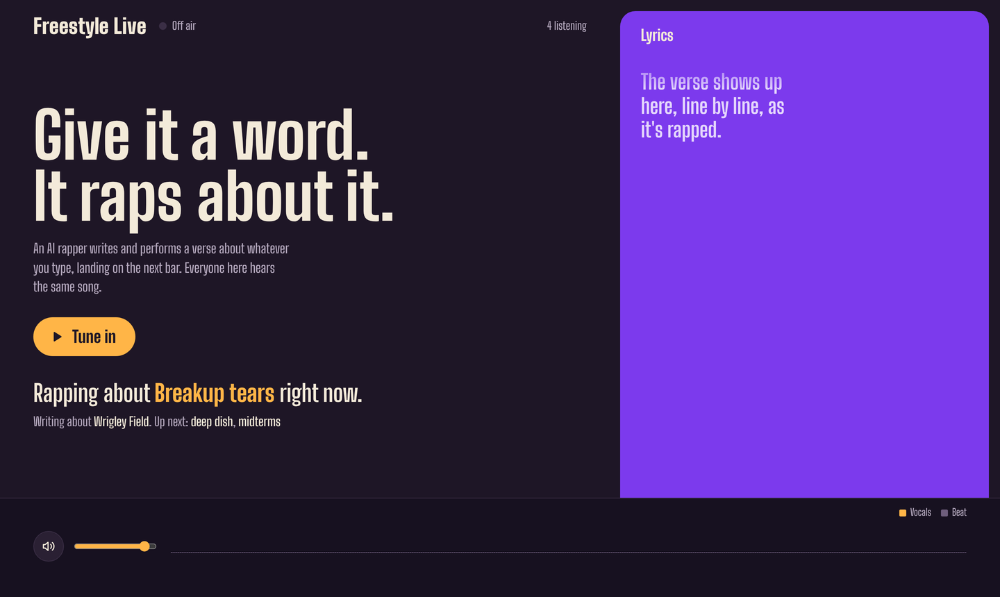
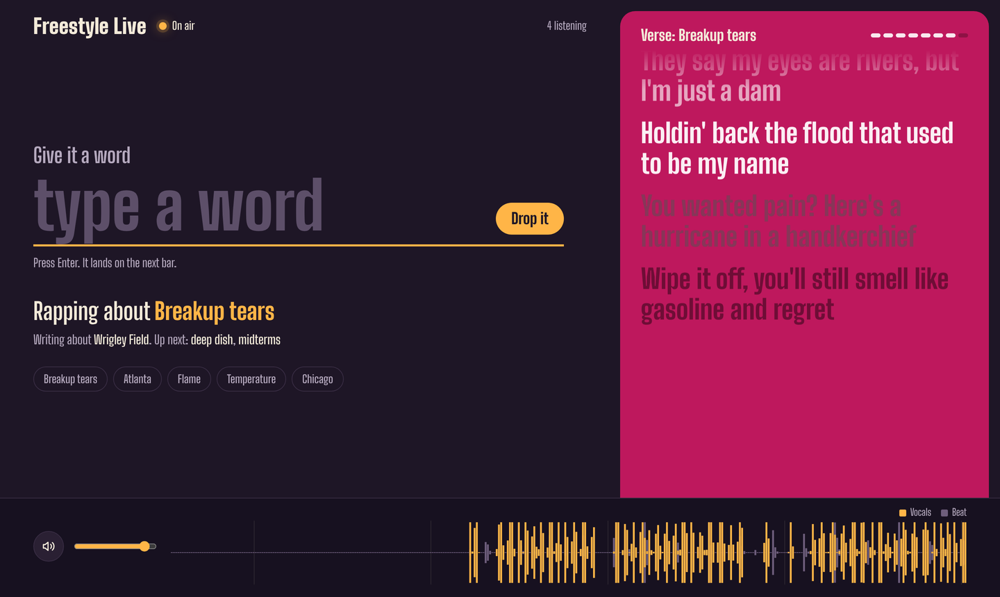
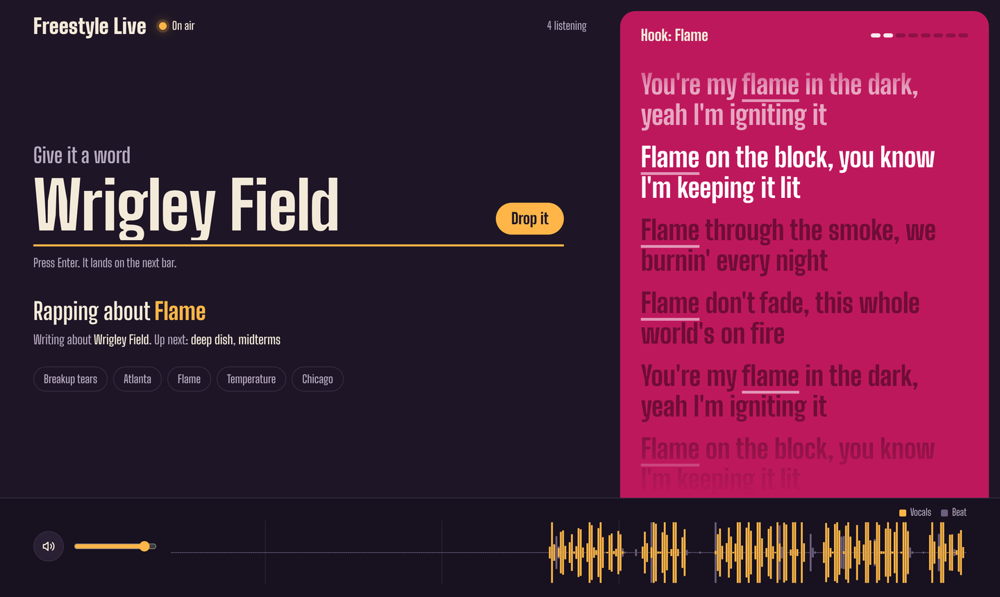
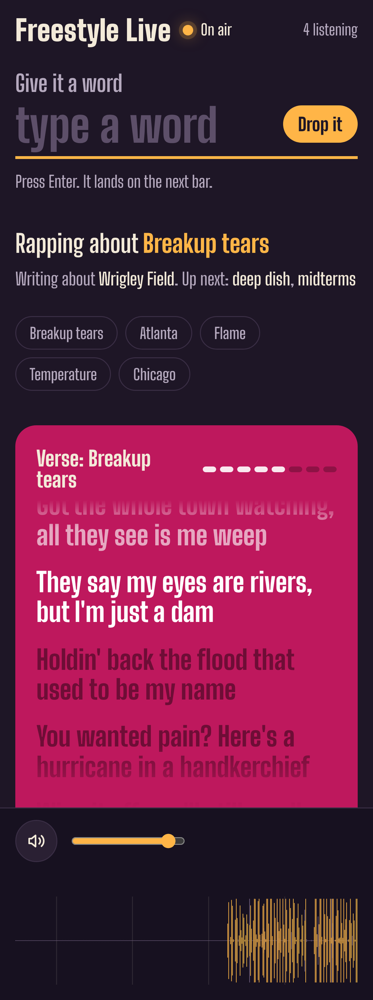
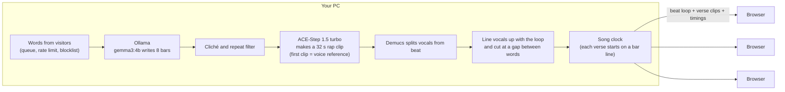

# Freestyle Live

**Give it a word. It raps about it.**

Freestyle Live is a nonstop AI rap song that runs on your own PC. Type a word on the website, and a few seconds later the rapper drops a verse about it, on the beat, with the lyrics scrolling along like Spotify. Friends can join through a link, hear the same song in their own browser, and throw in words of their own.

Everything runs locally: the lyrics come from a small language model in [Ollama](https://ollama.com), the music comes from [ACE-Step 1.5](https://github.com/ace-step/ACE-Step-1.5), and the vocals get split from the beat with [Demucs](https://github.com/adefossez/demucs). No API keys, no subscriptions.

## What it does

- **Words become verses.** Each word gets an 8-bar verse written about it, so the word means something in the bars and isn't just tacked on the end.
- **It sounds like a song.** Verses and hooks take turns (verse, hook, verse, verse, hook…), and every hook says the word at least twice.
- **The beat never stops.** One beat loops underneath the whole time. New vocals are lined up with it and drop in on the next bar line.
- **The lyrics follow along.** The line being rapped lights up, and the panel changes color with each new word.
- **Everyone hears the same song.** The website plays the audio in each visitor's browser on a shared clock, so a room full of phones stays in sync.
- **The crowd picks the words.** Anyone listening can add a word. Words wait in line (up to 5), and each visitor can send one every 8 seconds.
- **You can share it with a link.** One double-click makes a public link through a free Cloudflare tunnel.

| Before you tune in | A verse playing |
|---|---|
|  |  |

| A hook, with the next word being typed | On a phone |
|---|---|
|  |  |

## What you need

| | Tested with | Notes |
|---|---|---|
| OS | Windows 11 | The `.bat` launchers are Windows-only. The Python runs anywhere ACE-Step does. |
| GPU | NVIDIA RTX 4070 Ti (12 GB) | 12 GB is enough. Less may work with smaller settings. |
| RAM | 32 GB | 16 GB is the minimum ACE-Step recommends. |
| Disk | About 25 GB free | ACE-Step and its models, plus the lyric model. |

## Run it on your own PC

1. **Download this repo** (green **Code** button, then **Download ZIP**) and unzip it somewhere with a short path, like `C:\FreestyleLive`.
2. **Get ACE-Step.** Download the [ACE-Step 1.5 Windows portable package](https://files.acemusic.ai/acemusic/win/ACE-Step-1.5.7z) (about 5 GB) and extract it into the same folder. You should end up with `C:\FreestyleLive\ACE-Step-1.5\python_embeded\python.exe`.
3. **Install Ollama** from [ollama.com](https://ollama.com) (choose "No thanks, I'll use Ollama locally" if it asks you to sign up).
4. **Double-click `install.bat`.** It adds Demucs to ACE-Step's Python and downloads the lyric model (`gemma3:4b`, about 3 GB).
5. **Double-click `start_everything.bat`.** It starts the music engine, waits until it's ready, then opens the website at `http://127.0.0.1:5050`. The very first start also downloads ACE-Step's music models, so give it a few minutes.
6. Click **Tune in**, type a word, and press Enter.

To let other people in, double-click **`share_online.bat`** and send them the `https://….trycloudflare.com` link it prints. The link lasts until you close that window, and you get a new one each time.

### The files

| File | What it's for |
|---|---|
| `freestyle_live.py` | The show: writes lyrics, makes the music, separates vocals, keeps the song clock, and serves the website. |
| `ui.html` | The website. All the audio playback, lyric sync, and visualizer happen here, in the visitor's browser. |
| `install.bat` | One-time setup (Demucs and the lyric model). |
| `start_everything.bat` | Starts the engine and the website together. |
| `start_engine.bat` / `run_live.bat` | Start the music engine or the website on their own. |
| `share_online.bat` | Makes a public link (downloads Cloudflare's `cloudflared` the first time). |
| `blocked_words.txt` | Words visitors aren't allowed to submit, one per line. |
| `history/` | Every earlier version of the script, from the first one-word test onward. |
| `tools/diagnose.py` | A small test that saves raw ACE-Step output, for debugging. |

## Change how it sounds

Everything you'd want to tweak is at the top of `freestyle_live.py`:

| Setting | What it changes |
|---|---|
| `CAPTION` | The style of the music. It starts as a polished studio rap track at 90 BPM. |
| `BPM`, `KEY` | Tempo and key. Keep the BPM in `CAPTION` matching. |
| `PERSONA` | Who the rapper is (where they're from, their attitude). |
| `OLLAMA_MODEL` | Which lyric model writes the bars. `gemma3:4b` is the default because it fits next to the music model on a 12 GB card. |
| `BARS_PER_PIECE` | How long each verse is. |
| `VERSES_BETWEEN_HOOKS` | How many verses play before each hook. |
| `BANNED` | Phrases the lyric filter throws out, to keep the bars from getting corny. |

## How it works

1. **Lyrics.** The script asks the lyric model for 12 bars: 8 to keep and 4 extra, so the music model never thinks the song is ending. A filter throws out clichés ("bathed in light", "can't be beat"), repeated lines, and any planning notes the model writes to itself.
2. **Music.** ACE-Step's turbo model makes each clip in about 2–4 seconds on a 4070 Ti. Every clip after the first gets the first clip as a voice reference, so the rapper and the sound stay the same. ACE-Step's own planning model is switched off to leave room on the GPU.
3. **One beat.** Demucs splits the first clip into vocals and beat. That beat becomes the loop for the whole session.
4. **Lining up.** For each later clip, the script compares its drum hits to the loop's and shifts the vocals so they land on time, then ends them at the quietest gap near the 8-bar mark.
5. **The song clock.** Each verse is scheduled to start on a bar line. A new word replaces any normal verse that hasn't started yet.
6. **Playback.** Browsers download the beat once, then each verse clip, and play them with the Web Audio API at the exact scheduled times. The visualizer and the lyric highlight read from the same audio clock, so they stay in sync with what you hear.

When nobody has the page open, the script stops making new verses, so your GPU isn't working for an empty room.

## Before you share the link

- **Your PC is the server.** The site is only up while your PC, the engine, `run_live.bat`, and `share_online.bat` are all running.
- **Visitors' words turn into lyrics.** The lyric model is told to avoid slurs, hate, and sexual content, and visitors are rate-limited, but filtering isn't perfect. Add words to `blocked_words.txt` to block them.
- **Only the host can stop the show.** The "Stop the show" button only appears on the PC running it.
- **Bandwidth.** Each verse is about 2 MB per listener, which is fine for a group of friends.
- **Quick links are temporary.** For a permanent address, set up a named tunnel with a free Cloudflare account ([Cloudflare's guide](https://developers.cloudflare.com/cloudflare-one/connections/connect-apps)).

## If something goes wrong

| What you see | What to do |
|---|---|
| The public link shows a Cloudflare error | The website isn't running. Start `run_live.bat` (or `start_everything.bat`). |
| "Beat only" for a long time | The GPU is out of memory. Close games and other GPU apps. The engine window shows `Effective free VRAM`; it should stay above 0.5 GB. |
| `[error] music engine took over 90s` | Same as above. Restart the engine with `start_engine.bat`. |
| Lyrics look like notes ("Punchline idea: …") | The lyric model isn't following instructions. Stay on `gemma3:4b`. |
| "Port 5050/8001 is in use" | An old copy is still running. End leftover `python.exe` processes in Task Manager. |

## How it got here

This took 16 versions in one long afternoon, from "make one clip per word" to a shared website. The full story, with what broke at each step and how it got fixed, is in [docs/ITERATIONS.md](docs/ITERATIONS.md), and every version's code is in [history/](history/).

## Credits

- [ACE-Step 1.5](https://github.com/ace-step/ACE-Step-1.5) for music generation (MIT)
- [Demucs](https://github.com/adefossez/demucs) by Alexandre Défossez for vocal separation (MIT)
- [Ollama](https://ollama.com) for running the lyric model, and Google's [Gemma 3](https://ai.google.dev/gemma) (under the Gemma Terms of Use)
- [Big Shoulders](https://github.com/xotypeco/big_shoulders), a typeface made for Chicago (SIL Open Font License)
- [Cloudflare Tunnel](https://github.com/cloudflare/cloudflared) for the public link

The code in this repo is MIT licensed. The models and tools above keep their own licenses, and you download them yourself during setup.
