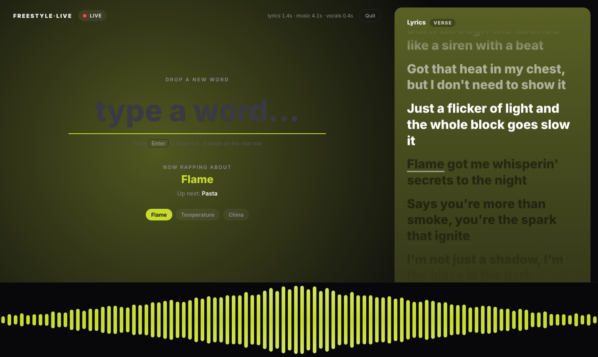
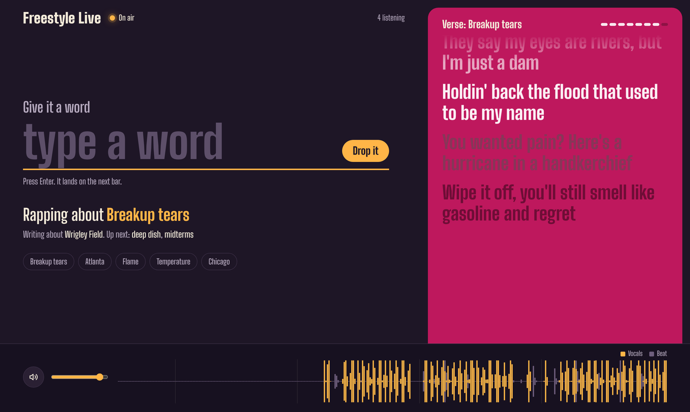
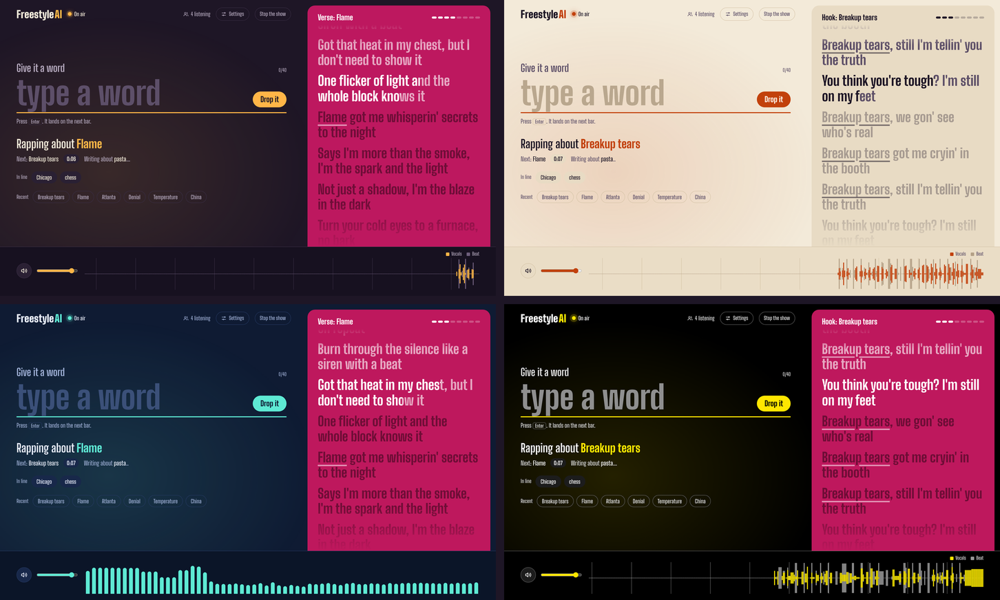
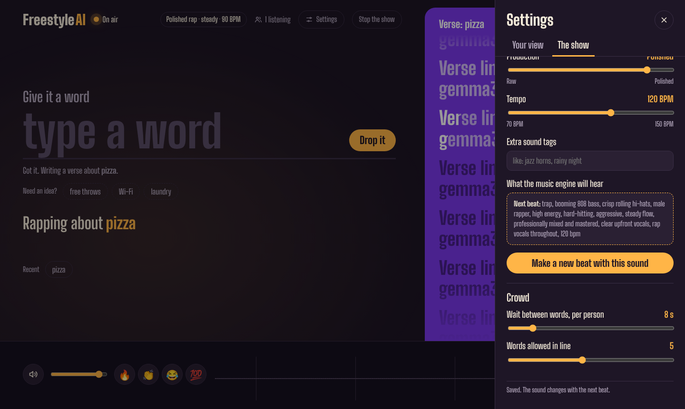

# How Freestyle AI got built

The goal from the start: something like Suno, running on my own PC, that raps continuously and works in whatever word I give it, like a freestyler would. Here's every version, what went wrong, and what fixed it. The code for each one is in [`../history/`](../history/).

Hardware the whole way through: Windows 11, RTX 4070 Ti (12 GB VRAM), 32 GB RAM.

## Phase 1: Is local music generation even fast enough?

**Setup.** ACE-Step 1.5 (Windows portable package) through its browser interface.

**First test.** A 30-second rap clip about "Chicago" took **36 seconds**, but almost all of that (34 s) was ACE-Step's built-in planning model. The actual music took under 2 seconds.

**Fix.** Turned the planner off. The same clip took **1.6 seconds** and sounded just as good. That one number is what made the whole project possible.

Caption testing settled the sound: a raw cypher style ("freestyle rap, off the top, raw cypher, conversational flow, boom bap") won over trap and lo-fi versions.

## v0: One word, one clip

[`v00_one_word_test.py`](../history/v00_one_word_test.py)

Type a word, Llama 3.1 8B (in Ollama) writes 8 bars, ACE-Step raps them, the clip plays. It worked, and it pronounced the words clearly, but each word was a separate song.

## v1: Nonstop chunks

[`v01_nonstop_chunks.py`](../history/v01_nonstop_chunks.py)

Made 20-second chunks back to back, writing the next one while the current one played, with a short crossfade between them.

**Problems.** The music kept pausing, the seams didn't line up, and the lyrics were corny ("I'm on the mic, got my flow on a roll, pizza").

## v2–v3: Continue the song instead of restarting it

Used ACE-Step's "repaint" feature to generate each chunk as a continuation of the last one.

**Problem 1.** A diagnostic showed ACE-Step treats a 10-second request as a whole song and wraps it up early: the rapping stopped at about **7 seconds**, then continuing that silence produced static.
**Fix.** Ask for twice as much song as needed and keep only the first part, so the model never thinks it's at the end.

**Problem 2.** Everything froze after a few words. Task Manager showed **11.0 / 12.0 GB** of VRAM used, with another 1.1 GB spilling into system RAM. Llama 3.1 8B and ACE-Step didn't fit together.

## v4: A smaller lyric model

[`v04_continuation_gemma.py`](../history/v04_continuation_gemma.py)

Switched to Gemma 3 4B, added timeouts so nothing hangs forever, and added a `PERSONA` setting.

**Bug found.** The model kept copying the example lines from the prompt back into the song ("Mama worked doubles, we split one pizza four ways" showed up again and again). Removed the example and told it never to repeat a line.

## v5: Keeping the voice from fading

[`v05_voice_anchor.py`](../history/v05_voice_anchor.py)

**Problem.** After a few chunks, the vocals faded out until only the beat was left. Each continuation was built on the previous continuation, so small losses stacked up.
**Fix.** Keep the first clip, which has strong vocals, as an "anchor" and include it every time.

## v6: Speed and cleanup

[`v06_speed_dedupe_cleanup.py`](../history/v06_speed_dedupe_cleanup.py)

Continuations had slowed to **8–18 seconds** each, longer than the chunks they made. Turned off ACE-Step's CPU offload and shortened the throwaway part. Also: drop any line the model already rapped, delete the engine's saved clips automatically (about **1 GB** had piled up), and write a timing log.

## v7: Song mode

[`v07_song_mode_hooks.py`](../history/v07_song_mode_hooks.py)

Instead of fighting to make it sound like a raw freestyle, aimed for a polished song that keeps going: a studio-rap caption, songwriter-style prompts, and a real song structure of verse → **hook** → verse → verse → hook. The hook says the word at least twice and repeats like a real chorus.

**Problem.** It started mumbling after the first few bars.

## v8: Fresh clips with a voice reference

[`v08_fresh_pieces_voice_reference.py`](../history/v08_fresh_pieces_voice_reference.py)

The log made the cause clear. The first clip, made fresh, came out clear and loud (loudness **0.147**). Every continuation got quieter and mumblier (down to **0.020**) and took 8–21 seconds.

**Fix.** Stop continuing entirely. Every clip is made fresh, the same way as the first one, and gets the first clip as a **voice reference** (ACE-Step's reference-audio feature) to keep the same rapper. Clips became 8 bars, cut on the bar line.

**Result.** Clear vocals, about 4 seconds per clip. The remaining issue was that every clip had its own slightly different beat.

## v9: One steady beat

[`v09_steady_beat_demucs.py`](../history/v09_steady_beat_demucs.py)

Added Demucs to split each clip into vocals and beat.

- The first clip's beat becomes a loop that plays the whole time and never changes.
- Each new clip's vocals get lined up with the loop by comparing drum hits, then dropped in on the next bar line.
- If the next vocals aren't ready, the beat keeps playing instead of going silent.

Vocal separation took about **0.4 seconds** per clip. This was the first version that sounded like one continuous song.

## v10: Fixing the corny lyrics

[`v10_anti_cliche_lyrics.py`](../history/v10_anti_cliche_lyrics.py)

The log showed the same clichés over and over: "bittersweet", "a soulful plea", "lost in the rhythm", "bathed in light", "can't be beat", plus a grandma in almost every verse. Added:

- A prompt that asks for punchlines, wordplay, and multi-syllable rhymes, with an original style example (and a check that rejects copies of it)
- A filter that drops any line containing about 35 overused phrases
- A "smart cut" that ends each clip at the quietest gap between words, so the last word doesn't get chopped

## v11–v12: Trying bigger lyric models

[`v12_qwen3_experiments.py`](../history/v12_qwen3_experiments.py)

**Qwen3 8B** wrote much better bars ("Hurricane in a handkerchief", "Denial got a face, but it don't show its teeth"), but it squeezed ACE-Step so hard that music took **11–14 seconds** per clip instead of 4. Splitting Qwen3 between GPU and CPU made it worse. **Qwen3 4B** fit, but kept writing its planning notes into the song ("Punchline idea: …", "*scribbles mental notes*").

## v13: First interface

[`ui_v13_local_player.html`](../history/ui_v13_local_player.html)

A page in the browser with a word box, Spotify-style lyrics, and a visualizer. The audio still played through the PC's speakers.

## v14–v15: Out of GPU memory again

[`v14_first_web_ui.py`](../history/v14_first_web_ui.py) · [`v15_vram_fixes.py`](../history/v15_vram_fixes.py)

ACE-Step's log showed **0.00 GB** of free VRAM, so it fell back to decoding audio on the CPU, which took minutes. Old lyric models from earlier tests were still sitting in GPU memory.

**Fixes.** Unload every other Ollama model on startup, turn ACE-Step's CPU offload back on (cheap now that there's no chaining), have Demucs hand its memory back after each split, go back to Gemma 3 4B, and filter out any line that looks like a note.

## v16: The website

The current [`freestyle_live.py`](../freestyle_live.py) and [`ui.html`](../ui.html).

- **Music plays in the browser,** not on the host's speakers. The server keeps one song clock, and each browser schedules the beat loop and verse clips on it with the Web Audio API, so everyone hears the same song.
- **Built for sharing.** A queue of up to 5 words from anyone listening, one word per visitor every 8 seconds, a blocklist, a host-only stop button, and no generating when nobody's listening.
- **Public link** through a free Cloudflare tunnel.
- **A redesigned interface:** set in Big Shoulders (a typeface made for Chicago), with an amber "on air" light, a lyrics panel that changes color per word with a bar counter, and a scrolling track showing vocals over the beat with a line at every bar.

## v17: Freestyle AI

Renamed the project to **Freestyle AI** and made the site feel more alive.

- **Settings,** saved in each visitor's browser: four themes (Studio, Daylight, Midnight, High contrast) or match the device, lyrics panel colored per word or matching the theme, three lyric sizes, a karaoke-style sweep across the active line, a tape or spectrum visualizer, and reduced motion.
- **Reactions to the music:** the background light pulses with the kick drum and the on-air light glows with the vocals.
- **Reactions to you:** a live countdown to the next verse, a "lands in 0:08" heads-up and a "you're on" note when your word comes up, your words marked in the queue, recent words you can tap to send again, a nudge when a word goes through and a shake when it doesn't, and keyboard shortcuts.

## v18: Running the show from the website

- **Host controls** in a new "The show" tab: lyric model (any model in Ollama), persona (empty means the default), language, creativity, tone, rhyme density, how often the word comes up, verses before each hook, and whether it keeps rapping between words. These apply to the next verse.
- **Sound sliders** for style, voice, energy, mood, flow, production, and tempo, with a live preview of the exact caption the music engine will get. **Make a new beat** rebuilds the loop in the new sound, and every listener's browser switches over on its own.
- **Crowd controls** for the wait between words and the size of the line. Only the host can change any of this; the server checks.
- **More reactive:** crowd reactions that float up on everyone's screen, word ideas to tap, verses that slide in line by line, a bar counter that pulses on each bar, a listener count that pops when people join, and a chip showing the current sound.
- A beat/vocal balance slider for each listener.

## v19–v20: Smarter lyrics, more languages

- Every verse was planned first (one clear angle plus three punchlines), with rules that put meaning before fancy rhymes and an original example verse to aim at. That fixed the word salad ("algorithms bleed", "interstellar station").
- Words in any script, Chinese added, and **Hindi in English letters** ("din raat"), which ACE-Step pronounces more naturally than Devanagari. Lines in the wrong language get dropped.
- Fixed a freeze: a bigger prompt window for the lyric model took GPU memory from the music engine.

## v21: Story mode in 4-bar chunks

**Problem.** Lines kept disappearing, often the rhyme at the end of a verse. ACE-Step doesn't sing exactly one line per bar, so when an 8-line verse ran long, the cut at the 8-bar mark chopped off the last line or two, and they were never sung.

**Fix.**
- **Chunks are 4 bars (about 10 seconds)** instead of 8, so each one is faster to make and a new word comes in sooner.
- **The script finds each sung line** in the vocals (runs of voice between breaths) and cuts right after the last finished line. Any line that didn't make it is carried to the front of the next chunk instead of being lost. The real line timings also go to the browser, so the lyric highlight follows the voice instead of guessing one line per bar.
- **One continuous story.** The song keeps a running story (who it's about and what's happening). Lines are written 8 at a time, continuing straight on from the last bar, and a new word gets woven into the story within the next two bars instead of starting a new verse.
- The lyrics panel scrolls through the whole song instead of replacing the text every verse.

## v22: Listening back to what was actually sung

**Problem.** Lines still showed up on screen that the rapper never sang. Counting the pauses in the vocals wasn't reliable: a breath in the middle of a line looked like two lines, and when ACE-Step skipped a line outright, the count still came out right, so the wrong lines were shown. The log also showed two prompt problems: the laundry example verse leaking into unrelated stories ("sorting laundry, whites from the colors", "detergent"), and the model rapping the instructions back ("Someone just threw a new word into the song: midterms").

**Fix.**
- **Whisper listens to every chunk.** After Demucs splits the vocals, Whisper (`whisper-base.en`, about 150 MB on the GPU) transcribes them with a time for each word. Those words are lined up with the lyric lines in order, and a line only counts as sung when enough of its own words (the ones no neighbouring line shares) were heard.
- The chunk is cut right after the last line that was really sung, without clipping the next word. Only heard lines are shown, at the times they were heard. Lines that come after the cut go back in the queue, and if nothing recognisable was sung, the chunk is made again with a new seed.
- English only for now. Other languages still count the pauses, and so does English if Whisper can't load.
- **Faster clips.** Only the first 4 bars of the first clip are sent as the voice reference, instead of the whole 27-second clip.
- The first try at loading Whisper went through Transformers' speech pipeline, which needs FFmpeg on Windows and failed, so the check silently fell back to counting pauses. Whisper's model is now called directly, with no FFmpeg needed.
- The lyrics panel scrolls: scroll up to read back through the song, and a "Back to live" button jumps to the current line. The highlight also waits for the speakers' output delay and lights each line when its first word is sung, so it no longer runs ahead.
- Story mode no longer shows the model an example verse, the new-word prompt is reworded, and lines that echo the instructions are filtered out.

## v23: Undoing what made it mumble

Once Whisper worked, the log showed what was really coming out: lots of "yeah yeah yeah" and half-heard lines. Music also slowed to 15–35 seconds a clip, so retries left long stretches of beat only.

- **The full first clip is the voice reference again.** Cutting it to 4 bars was the change that came right before the mumbling.
- **Whisper runs on the CPU,** so it never takes GPU memory from the music engine.
- **No more retries.** A chunk always plays about 4 bars of vocals with no gaps. Only the lines Whisper heard are shown, and if it heard nothing it moves on instead of getting stuck on the same lines.
- A line only counts as finished if its last words were heard, so the cut never lands mid-line. Matching is a little looser, since Whisper mishears fast rap.
- Lines are capped at 11 words, because long lines don't fit in one bar and get mumbled.

## v24: A locked sound and a locked lyric format

The log showed two separate problems. The R&B style made the engine sing long notes ("oh oh oh…"), which stretched lines past the bar and got them chopped. And Whisper was getting lost on its own, "hearing" nothing but "yeah yeah yeah", so good chunks were thrown out.

- **Clear rap (locked)** is the new default sound: one fixed caption tuned for a single rapper saying every word on the beat. The energy, mood, flow, and production sliders sit out while it's picked.
- **Locked lyric format:** 7–10 words a line, no commas or dashes inside a line, and rhymes in pairs on the last word. The music engine gets the words with the punctuation stripped out.
- **Whisper gets the expected lyrics as a hint,** which makes it much better at hearing fast rap. If it still comes back with one word over and over, or hears almost nothing while someone is clearly rapping, that chunk falls back to counting pauses instead of hiding every line.

## What I'd try next

- Run on a bigger GPU (Qwen3 8B or larger for lyrics, ACE-Step XL for sound) through UIC's research cluster or a free notebook GPU, to see how much better it gets
- Train an ACE-Step LoRA on freestyle recordings so it sounds less like a studio track and more like a live cypher
- A permanent public address with a named Cloudflare tunnel
